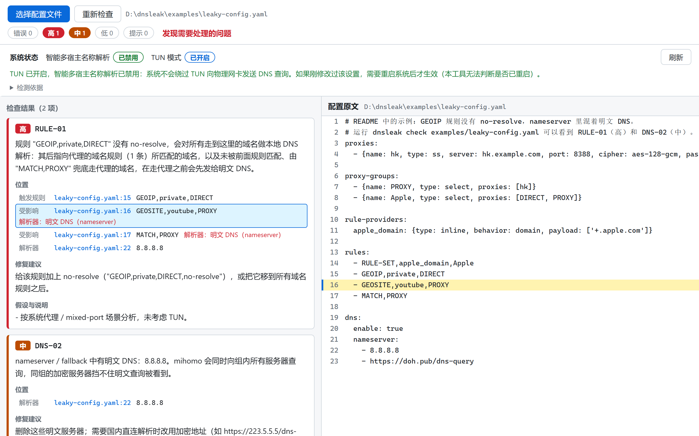
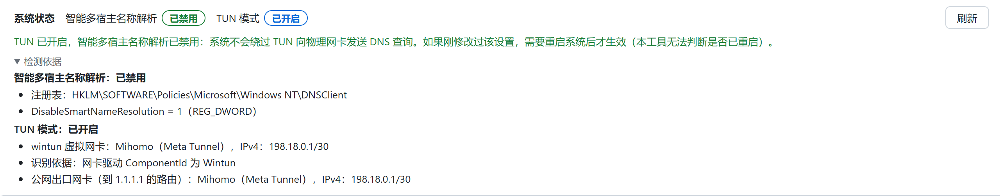

# 滴水不漏 DNSnitch

Clash / mihomo 配置 DNS 泄露检测。

名字的来历：「滴水不漏」是这个工具想帮你做到的事，「滴」也正好念作 D，算是给 DNS 留了个位置。英文名是 DNS 和 snitch（告密者）的合写，泄露的 DNS 就是那个替你告密的家伙。程序名统一用小写的 `dnsnitch`。

开着代理看 YouTube，流量确实走了节点，但运营商照样可能知道你在访问 `www.youtube.com`。问题通常出在配置的几处写法上，它们让本该走代理的域名先在本地查了一次 DNS。下面先说泄露是怎么发生的，再说这个工具怎么用，以及它给出的风险等级怎么理解。

<picture>
  <source media="(prefers-color-scheme: dark)" srcset="docs/images/gui-check-dark.png">
  
</picture>

## DNS 泄露是怎么回事

正常情况下，mihomo 判断 `youtube.com` 要走代理后，会把域名原样交给代理节点，由节点那边去解析。本地网络上不会出现任何关于 `youtube.com` 的 DNS 查询。

如果这个域名在本地被查了一次，哪怕最后流量还是走的代理，收到这次查询的一方也已经知道你要访问 YouTube 了。至于谁能看到，要看查询发给了谁：

- 发给 `8.8.8.8`、`223.5.5.5`、`114.114.114.114` 这类明文 DNS：路上的所有人都能看到，包括运营商。
- 发给 `https://223.5.5.5/dns-query` 这类国内的加密 DNS：运营商看不到，阿里、腾讯这些 DNS 服务商能看到。
- 发给 `https://1.1.1.1/dns-query#PROXY` 这种走代理的加密 DNS：本地网络上谁都看不到。

顺便一提，很多教程说把 DNS 改成 `8.8.8.8` 就行了。但 `8.8.8.8` 默认是明文 UDP 查询，路上的人照样能看到你查了什么。

## 常见的几种写法问题

### IP 规则没加 no-resolve

这是最常见的一种。mihomo 的规则从上往下匹配，遇到 `GEOIP`、`IP-CIDR` 这类 IP 规则时，如果请求是域名，它得先把域名解析成 IP 才能判断。解析用的是 `nameserver`，而且这时候还不知道这个域名最后走直连还是走代理。

```yaml
rules:
  - RULE-SET,apple_domain,Apple
  - GEOIP,private,DIRECT          # 没有 no-resolve，走到这一行的域名都会先查 DNS
  - GEOSITE,youtube,PROXY         # youtube.com 在上一行已经被查过了
  - MATCH,PROXY
dns:
  enable: true
  nameserver:
    - 8.8.8.8                     # 明文，youtube.com 被看到
    - https://doh.pub/dns-query
```

给 IP 规则加上 `no-resolve`，或者把 IP 规则都挪到域名规则后面：

```yaml
  - GEOIP,private,DIRECT,no-resolve
```

类似的情况还有：把 IP 和域名混在一起的 classical 规则集、引用 IP 规则集时没写 `no-resolve`（比如 `RULE-SET,cn_ip,DIRECT`）、`AND` / `OR` 这类逻辑规则里夹着 IP 条件。道理都一样。

### nameserver 里混了明文 DNS

```yaml
dns:
  nameserver:
    - 8.8.8.8                     # clash-verge 的默认 DNS 覆写里就有这一行
    - https://doh.pub/dns-query
    - https://dns.alidns.com/dns-query
```

mihomo 会同时向这几个服务器发查询，所以后面两个 DoH 等于白配，`8.8.8.8` 那份照样是明文出去的。规则写对的时候它暂时用不上，但只要哪天规则改错一条，就会漏。用 clash-verge 并开了 DNS 覆写的话，机场给的配置本来没问题，也会被这一行改坏。

### Windows 下开 TUN

Windows 默认开着「智能多宿主名称解析」，会同时往所有网卡发 DNS 查询。开了 TUN 以后，Clash 只能拦到发往虚拟网卡的那一份，发往物理网卡的那份直接到了运营商那里。也就是说，系统默认设置下开 TUN，一定会泄露。

专业版可以在组策略里打开「计算机配置 → 管理模板 → 网络 → DNS 客户端 → 禁用智能多宿主名称解析」。家庭版没有组策略，用管理员身份执行下面这条命令，然后重启：

```bat
reg add "HKLM\SOFTWARE\Policies\Microsoft\Windows NT\DNSClient" /v DisableSmartNameResolution /t REG_DWORD /d 1 /f
```

### 其他

- 键名写错，比如 `nameserver-policy` 写成 `nameserver-police`。mihomo 不报错，直接忽略这一段，很难发现。
- 用 `GEOIP,CN,DIRECT,no-resolve` 兜底。加了 `no-resolve` 后，这条规则对域名请求不起作用。
- 没写 `dns.enable: true`。mihomo 默认不启用自己的 DNS，规则需要解析时直接用系统 DNS，也就是明文。

## dnsnitch 能做什么

这些问题靠翻配置不好找，几百上千行的订阅配置更是看不过来。抓包能确认有没有漏，但看不出是哪一行导致的。所以我写了 dnsnitch，读配置文件直接分析：

- 不运行 mihomo，不联网，不改任何文件。
- 判断依据对照过 mihomo v1.19.33 的源码，包括哪些规则会触发解析、查询会发给哪个 DNS。
- 报告会指到具体行号，说明是哪条规则让哪些域名被解析、发给了哪个 DNS，以及怎么改。
- 在 Windows 上还能只读地检查 TUN 有没有真的开着、智能多宿主名称解析有没有禁用。

有命令行和桌面窗口两个版本。

### 命令行

```bash
dnsnitch check config.yaml                    # 检查配置
dnsnitch trace config.yaml www.youtube.com    # 看这个域名会被哪个 DNS 查到
dnsnitch status                               # 检查本机的 TUN 和智能多宿主名称解析
```

都可以加 `--format json`。上面第一个例子补上节点和策略组后，放在 [examples/leaky-config.yaml](examples/leaky-config.yaml) 里，跑一下：

```
$ dnsnitch check examples/leaky-config.yaml

[高] RULE-01  examples/leaky-config.yaml:15
  规则 "GEOIP,private,DIRECT" 没有 no-resolve，会对所有走到这里的域名做本地 DNS 解析：其后指向代理的域名规则（1 条）所匹配的域名，以及未被前面规则匹配、由 "MATCH,PROXY" 兜底走代理的域名，在走代理之前会先发给明文 DNS。
  位置：
    触发规则   examples/leaky-config.yaml:15  GEOIP,private,DIRECT
    受影响    examples/leaky-config.yaml:16  GEOSITE,youtube,PROXY  → 明文 DNS（nameserver）
    受影响    examples/leaky-config.yaml:17  MATCH,PROXY  → 明文 DNS（nameserver）
    解析器    examples/leaky-config.yaml:22  8.8.8.8
  修复：给该规则加上 no-resolve（"GEOIP,private,DIRECT,no-resolve"），或把它移到所有域名规则之后。

[中] DNS-02  examples/leaky-config.yaml:22
  nameserver / fallback 中有明文 DNS：8.8.8.8。mihomo 会同时向组内所有服务器查询，同组的加密服务器挡不住明文查询被看到。
  修复：删除这些明文服务器；需要国内直连解析时改用加密地址（如 https://223.5.5.5/dns-query）。

汇总：错误 0，高 1，中 1，低 0，提示 0
```

按提示给 GEOIP 加上 `no-resolve` 后再跑，高风险那条就没了，只剩下 nameserver 里的 `8.8.8.8`。

规则集缓存和 `GeoSite.dat` 默认在配置文件同目录下找，不在一起的话用 `--home` 指定 mihomo 的数据目录。另外要注意，各客户端实际在用的配置不一定是你订阅的那份，比如 mihomo-party 用的是 `%APPDATA%\mihomo-party\work\config.yaml`。

### 桌面窗口

打开 `dnsnitch-gui`，选择或者直接拖入配置文件。左边是检查结果，点结果里的行号，右边会跳到配置原文的对应位置。文章开头那张图就是检查 `examples/leaky-config.yaml` 的结果。

窗口顶部一直显示本机 TUN 和智能多宿主名称解析的状态，可以随时刷新。展开「检测依据」能看到判断用的注册表值和网卡信息：



## 风险等级

等级看两点：查询会被谁看到，以及是每次都会发生还是只是可能发生。

**高**：运营商能看到你访问了哪些需要代理的网站。比如上面第一个例子，IP 规则没加 `no-resolve`，nameserver 里又有明文 DNS；或者在 `nameserver-policy` 里把 `geosite:geolocation-!cn` 交给了 `114.114.114.114`。系统状态那边，开着 TUN 又没禁用智能多宿主名称解析，也算高。

**中**：运营商看不到，但国内的 DNS 服务商能看到。比如同样是 IP 规则没加 `no-resolve`，但 nameserver 用的是 `https://223.5.5.5/dns-query`。还有一类是现在没漏、但很容易漏的：nameserver 里混着 `8.8.8.8`；规则里点名的网站没问题，没覆盖到的网站靠 `MATCH,PROXY` 兜底时会以明文查一次；DNS 相关的键名写错导致设置没生效。

**低**：只有境外的服务商能看到，或者漏出去的不是你访问的网站。比如查询发给了没加 `#PROXY` 的 `https://1.1.1.1/dns-query`；`proxy-server-nameserver` 用了明文 DNS，漏的是机场节点的域名。

**提示**：算不上泄露，但可以改。比如 DNS 查询本身走了代理，只是多查了一次（《Clash.Meta DNS 配置指南》里推荐的配置就是这样）；`GEOIP,CN,DIRECT,no-resolve` 当兜底不起作用；`MATCH,DIRECT` 的白名单写法；还在用 `fallback`。

**错误**：配置写错了，mihomo 根本加载不了。比如开了 `respect-rules` 却没配 `proxy-server-nameserver`，`default-nameserver` 写成了域名，规则里引用了不存在的策略组。

有错误、高、中任意一项时，命令行退出码是 1，窗口里显示「发现需要处理的问题」。只有低和提示时显示「未发现泄露风险」。

## 下载

当前版本 v0.1.0，历史版本见 [Releases](https://github.com/gxcuit/DNSnitch/releases)。

| 版本 | 下载 |
| --- | --- |
| Windows 桌面窗口 | [dnsnitch-gui_v0.1.0_windows_amd64.zip](https://github.com/gxcuit/DNSnitch/releases/download/v0.1.0/dnsnitch-gui_v0.1.0_windows_amd64.zip) |
| Windows 命令行（x64） | [dnsnitch_v0.1.0_windows_amd64.zip](https://github.com/gxcuit/DNSnitch/releases/download/v0.1.0/dnsnitch_v0.1.0_windows_amd64.zip) |
| Windows 命令行（ARM64） | [dnsnitch_v0.1.0_windows_arm64.zip](https://github.com/gxcuit/DNSnitch/releases/download/v0.1.0/dnsnitch_v0.1.0_windows_arm64.zip) |
| macOS 命令行（Apple 芯片） | [dnsnitch_v0.1.0_darwin_arm64.tar.gz](https://github.com/gxcuit/DNSnitch/releases/download/v0.1.0/dnsnitch_v0.1.0_darwin_arm64.tar.gz) |
| macOS 命令行（Intel） | [dnsnitch_v0.1.0_darwin_amd64.tar.gz](https://github.com/gxcuit/DNSnitch/releases/download/v0.1.0/dnsnitch_v0.1.0_darwin_amd64.tar.gz) |
| Linux 命令行（x86_64） | [dnsnitch_v0.1.0_linux_amd64.tar.gz](https://github.com/gxcuit/DNSnitch/releases/download/v0.1.0/dnsnitch_v0.1.0_linux_amd64.tar.gz) |
| Linux 命令行（ARM64） | [dnsnitch_v0.1.0_linux_arm64.tar.gz](https://github.com/gxcuit/DNSnitch/releases/download/v0.1.0/dnsnitch_v0.1.0_linux_arm64.tar.gz) |

校验值：[SHA256SUMS.txt](https://github.com/gxcuit/DNSnitch/releases/download/v0.1.0/SHA256SUMS.txt)。main 分支的最新构建：[nightly](https://github.com/gxcuit/DNSnitch/releases/tag/nightly)。

macOS 提示「无法验证开发者」时，执行 `xattr -d com.apple.quarantine ./dnsnitch`。

## 构建

需要 Go 1.27 以上。

```bash
go build -o dnsnitch ./cmd/dnsnitch
```

命令行版是纯 Go，可以直接交叉编译到 Linux 和 macOS。桌面窗口用的是 Wails v2 和 Vue 3，还需要 Node.js 和 Wails CLI，详细步骤见 [gui/README.md](gui/README.md)：

```bash
go install github.com/wailsapp/wails/v2/cmd/wails@v2.17.1
cd gui && wails build
```

## 还没做的

- 配置检查目前按系统代理 / mixed-port 的场景分析，TUN 模式下 fake-ip、dns-hijack 这些配置项还没查，TUN 相关的只有 `status` 那一项。
- `nameserver-policy` 和规则是按名字对应的，名字不同但内容有重叠的规则集认不出来。想确认某个具体域名，用 `trace`。
- 系统状态检查只支持 Windows。
- 只支持 mihomo（Clash.Meta），不支持已经停更的原版 Clash。

## 参考

判断逻辑主要来自下面几篇文章：

- [解决DNS泄露最佳实践——基于 ClashMeta](https://blog.arisa.moe/blog/2025/250814-best-practice-of-anti-dns-leak/)，Akiba Arisa
- [Clash.Meta DNS 配置指南](https://blog.akise.app/posts/clash-dns-configure/)，Aki Akise
- DNS 泄漏可能比你想的范围广，以及 clash 与 tailscale 共同使用的配置
- [Windows 系统下 Clash 系代理软件虚拟网卡（TUN）模式的 DNS 泄露问题及解决方案](https://wildprobe.com/soft-technical/dnsleak/)，野生网管

## 许可证

[GPL-3.0](LICENSE)。读取 `.mrs` 规则集的代码来自 [mihomo](https://github.com/MetaCubeX/mihomo)。
